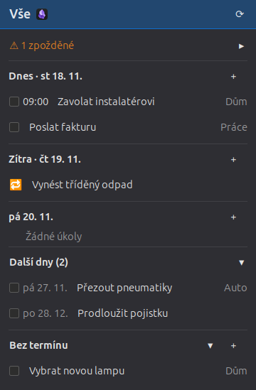

# VaultQuick Desktop – úkoly z Obsidianu na liště MATE

Applet pro panel prostředí **MATE** (Linux Mint MATE, Ubuntu MATE…), který ukazuje úkoly
z vašeho vaultu [Obsidian](https://obsidian.md) spravované pluginem
[TaskNotes](https://github.com/callumalpass/tasknotes).



- **Na liště** počet dnešních a zpožděných úkolů (volitelně s ikonou projektu).
- **Po kliknutí** agenda: zpožděné, dnes a dalších několik dní, pozdější termíny a úkoly
  bez termínu.
- **Odškrtnutí** úkolu přímo v okně, **＋** pro rychlé přidání úkolu na zvolený den,
  formulář pro úpravu úkolu, otevření poznámky v Obsidianu.
- **Více instancí** na liště – např. jedna pro všechny úkoly a další pro jednotlivé projekty.
- **Klávesová zkratka** (např. Super+T) pro otevření okna.

Applet pracuje přímo se soubory ve vaultu, Obsidian nemusí běžet. Rozhraní je česky.

## Požadavky

- Pracovní prostředí **MATE** s panelem `mate-panel` (v GNOME, Cinnamonu, KDE apod. applet nefunguje).
- Vault Obsidianu s pluginem **TaskNotes** – každý úkol je samostatná poznámka (`.md`)
  s vlastnostmi jako `status`, `due`, `scheduled`, `projects`. Applet čte nastavení TaskNotes
  z `.obsidian/plugins/tasknotes/data.json` ve vaultu.
- Python 3 s GTK 3, knihovna appletů MATE a Java (JDK 17 nebo novější).

## Instalace krok za krokem

### 1. Balíčky

Linux Mint / Ubuntu / Debian:

```
sudo apt install git python3-gi gir1.2-gtk-3.0 gir1.2-matepanelapplet-4.0 default-jdk
```

### 2. Stažení

```
git clone https://github.com/PeSstudios/VaultQuickDesktop.git
cd VaultQuickDesktop
```

### 3. Cesta k vaultu

Vytvořte `~/.config/vaultquick-desktop/config.json` s cestou ke svému vaultu
(místo `~/Dokumenty/MujVault` dejte vlastní):

```
mkdir -p ~/.config/vaultquick-desktop
echo '{ "vault": "~/Dokumenty/MujVault" }' > ~/.config/vaultquick-desktop/config.json
```

Bez tohoto souboru applet hledá vault v `~/MujVault`.

### 4. Instalace

```
./applet/install.sh --shortcut '<Mod4>t'
```

`--shortcut '<Mod4>t'` je volitelné – založí klávesovou zkratku Super+T. Skript sestaví pomocníka
(poprvé to trvá několik minut, Gradle si stáhne potřebné knihovny) a jednou požádá o heslo
pro `sudo` (zápis souboru appletu do `/usr/share/mate-panel/applets/`). Vše ostatní se instaluje
jen do vašeho domovského adresáře.

### 5. Přidání na lištu

Restartujte panel:

```
mate-panel --replace &
```

Pak pravý klik na panel → **Přidat na panel…** → **Úkoly VaultQuick**.

## Použití

- **Klik** na applet otevře okno s agendou, další klik (nebo Esc) ho zavře.
- **Zaškrtávací pole** úkol dokončí, klik na název úkolu otevře formulář, **＋** u dne přidá úkol.
- **Pravý klik** na applet → **Předvolby** (nastavení této instance) nebo **Obnovit**.
- Můžete přidat více instancí (např. Vše, Práce, Dům) – každá má vlastní předvolby.

### Předvolby instance

- projekt (název stránky) nebo Vše, popisek na liště,
- počet dní 1–14 (výchozí 7),
- úkoly bez termínu: žádné / rozpracované / všechny (výchozí: projekt všechny, Vše rozpracované),
- velikost písma (výchozí 11 pt),
- ikona na liště: **Podle projektu** (výchozí – obrázek z vlastnosti `ikona:` stránky projektu ve
  formátu pluginu Image Icons, např. `ikona: "[[g4.png]]"`; instance Vše a projekty bez `ikona:`
  ikonu nemají), **Vybrat obrázek…** (libovolný obrázek z vaultu – png, jpg, jpeg, gif, webp, svg,
  bmp; soubor mimo vault se neuloží) nebo **Bez ikony**. Obrázek se neořezává, jen se zmenší na
  výšku lišty se zachováním poměru stran,
- **Zobrazit i popisek** (výchozí ne): s ikonou jsou na liště jen počty a popisek je v tooltipu;
  bez ikony se popisek ukazuje vždy,
- **Klik na název** v záhlaví okna: otevřít soubor v Obsidianu (výchozí stránka projektu, u Vše
  stránka TaskNotes; **Vybrat…** = libovolný soubor z vaultu) nebo otevřít složku ve správci
  souborů (výchozí kořen vaultu). **Výchozí** vrátí výchozí cíl.

Ikona ze stránky projektu se zjišťuje při startu appletu, po uložení Předvoleb a při ručním
Obnovit – po změně `ikona:` v Obsidianu stačí Obnovit.

V okně je tolik dní, kolik je v Předvolbách; úkoly s pozdějším termínem jsou ve sbalitelné sekci
**Další dny** (každý jednou, s nejbližším termínem a datem; opakované podle `scheduled`).
Sekce **Bez termínu** má také ＋ – zapíše úkol bez termínu do projektu instance.

Nastavení instancí je v `~/.config/vaultquick-desktop/instances.json`.

### Klávesová zkratka

`install.sh --shortcut '<Mod4>t'` založí vlastní zkratku MATE (dconf
`/org/mate/desktop/keybindings/customN/`, první volné N; pokud už zkratka se stejnou akcí existuje,
přeskočí se). Super+T pak otevře/zavře okno instance Vše. Totéž ručně:
Ovládací centrum → Klávesové zkratky → Přidat, příkaz `~/.local/bin/vaultquick-desktop toggle`.

```
vaultquick-desktop toggle          # instance Vše (jinak první na liště)
vaultquick-desktop toggle Práce    # instance s popiskem „Práce“
```

Funguje jen, když applet na liště běží.

## Konfigurace

`~/.config/vaultquick-desktop/config.json`:

```json
{
  "vault": "~/MujVault",
  "taskPreset": { "folder": "Úkoly", "fileNameTemplate": "…", "tags": ["task"] }
}
```

- `vault` – cesta k vaultu (výchozí `~/MujVault`),
- `taskPreset` – volitelné; složka, šablona názvu souboru a tagy nových úkolů (jinak se vezmou
  z nastavení TaskNotes ve vaultu).

## Aktualizace

```
git pull
./applet/install.sh
mate-panel --replace &
```

## Odinstalace

```
./applet/install.sh --uninstall
```

Smaže nainstalované soubory (včetně `sudo rm` souboru appletu v `/usr/share/mate-panel/applets/`).
Ručně pak odeberte applet z lišty, zkratku v Klávesových zkratkách a případně
`~/.config/vaultquick-desktop/`.

## Pro vývojáře

Applet je v Pythonu (GTK 3, `applet/`). Data z vaultu mu dodává pomocník `vqd` (Kotlin, JVM,
`vqd/`) – jeden proces pro všechny instance appletu, komunikace řádky JSON přes stdin/stdout.

`install.sh` sestaví `vqd` (`./gradlew :vqd:installDist`, potom `./gradlew --stop`) a nainstaluje:

- `vqd` → `~/.local/share/vaultquick-desktop/vqd/`
- applet → `~/.local/share/vaultquick-desktop/applet/`
- D-Bus služba → `~/.local/share/dbus-1/services/` (s cestou k nainstalovanému appletu)
- příkaz `vaultquick-desktop` → `~/.local/bin/`
- soubor appletu → `/usr/share/mate-panel/applets/` (sudo)

Skript je idempotentní. Přepínače: `--skip-build` (bez Gradle), `--dry-run` (jen vypíše kroky),
`--shortcut`, `--uninstall`. Zkratka volá D-Bus metodu `Toggle` na `cz.pesstudios.VaultQuickDesktop`.

Testy:

```
python3 -m unittest discover -s applet/tests     # GTK testy: VQ_GUI_TESTS=1
./gradlew :vqd:test
```

Jádro pomocníka `vqd` (`vqd/src/main/kotlin/…/core/**`, `vault/`, `reminders/`) je převzaté
z Android aplikace VaultQuick a kompiluje se jako obyčejné JVM – nesmí importovat `android.*`
ani `androidx.*`.

## Licence

MIT – viz [LICENSE](LICENSE).
