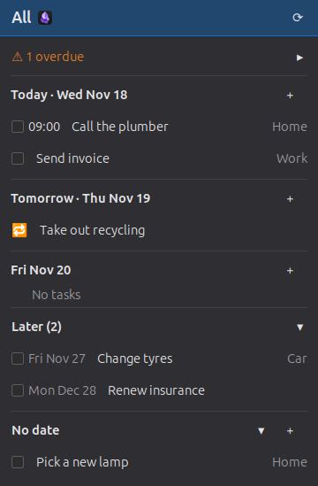

# VaultQuick Desktop – Obsidian tasks on the MATE panel

**English** | [Česky](README.cs.md)

A panel applet for the **MATE** desktop (Linux Mint MATE, Ubuntu MATE…) that shows tasks from
your [Obsidian](https://obsidian.md) vault managed by the
[TaskNotes](https://github.com/callumalpass/tasknotes) plugin.



- **On the panel:** the number of today's and overdue tasks (optionally with a project icon).
- **On click:** an agenda with overdue tasks, today and the next few days, later due dates and
  tasks without a date.
- **Check off** a task right in the window, **＋** to quickly add a task to a given day, a form
  to edit a task, open the note in Obsidian.
- **Multiple instances** on the panel – e.g. one for all tasks and one per project.
- **Keyboard shortcut** (e.g. Super+T) to open the window.

The applet works directly with the files in your vault; Obsidian doesn't need to be running.
The interface is in English or Czech, following the system language (force it with
`VQ_LANG=en` / `VQ_LANG=cs`).

## Requirements

- The **MATE** desktop with `mate-panel` (the applet doesn't work in GNOME, Cinnamon, KDE etc.).
- An Obsidian vault with the **TaskNotes** plugin – every task is a separate note (`.md`) with
  properties such as `status`, `due`, `scheduled`, `projects`. The applet reads the TaskNotes
  settings from `.obsidian/plugins/tasknotes/data.json` in the vault.
- Linux Mint, Ubuntu or Debian (for installing the `.deb` package).

## Installation

### 1. Download and install the package

Download `vaultquick-desktop_…_all.deb` from the
[latest release](https://github.com/PeSstudios/VaultQuickDesktop/releases/latest)
and open it with a double-click (Java and the other dependencies are installed automatically).
Or in a terminal:

```
sudo apt install ./vaultquick-desktop_1.3.0_all.deb
```

### 2. Add it to the panel

Log out and back in (or restart the panel with `mate-panel --replace &`).
Then right-click the panel → **Add to Panel…** → **VaultQuick Tasks**.

### 3. Choose your vault

Click the applet. On first start it shows **Vault not found** and a **Choose vault…** button –
pick the folder of your Obsidian vault. You can change it later via right-click on the applet →
**Choose vault…**.

### 4. Keyboard shortcut (optional)

Control Center → Keyboard Shortcuts → **Add**, name e.g. "Tasks", command
`vaultquick-desktop toggle`, then assign the keys (e.g. Super+T).

### Installing from source

Without the package, e.g. on another distribution with MATE:

```
sudo apt install git python3-gi gir1.2-gtk-3.0 gir1.2-matepanelapplet-4.0 default-jdk
git clone https://github.com/PeSstudios/VaultQuickDesktop.git
cd VaultQuickDesktop
./applet/install.sh --shortcut '<Mod4>t'
mate-panel --replace &
```

`install.sh` builds the helper (the first build takes a few minutes while Gradle downloads its
libraries), installs everything into your home directory and asks for `sudo` once (for the
applet file in `/usr/share/mate-panel/applets/`). `--shortcut` also creates the keyboard shortcut.

## Usage

- **Click** the applet to open the agenda window; click again (or press Esc) to close it.
- The **checkbox** completes a task, clicking a task title opens the form, **＋** next to a day
  adds a task.
- **Right-click** the applet → **Preferences…** (settings of this instance), **Refresh**,
  **Open in Obsidian** or **Choose vault…**.
- You can add several instances (e.g. All, Work, Home) – each has its own preferences.

### Instance preferences

- project (page name) or All, label on the panel,
- number of days 0–14 (default 7); **0** = no tasks in the window (not even overdue, later or
  undated ones), just the file manager and Obsidian links,
- tasks without a date: none / in progress only / all (default: all for a project, in progress
  for All),
- font size (default 11 pt),
- panel icon: **From project** (default – the image from the `ikona:` property of the project
  page in the format of the Image Icons plugin, e.g. `ikona: "[[g4.png]]"`; the All instance and
  projects without `ikona:` have no icon), **Choose image…** (any image from the vault – png, jpg,
  jpeg, gif, webp, svg, bmp; files outside the vault are rejected) or **No icon**. The image is
  never cropped, only scaled to the panel height keeping its aspect ratio,
- **Show label too** (default off): with an icon the panel shows only the counts and the label
  is in the tooltip; without an icon the label is always shown,
- **Open in file manager** and **Open in Obsidian**: the checked rows are shown below the window
  header (both by default). With 0 days and only one row checked, clicking the applet opens its
  target directly, without the window. The target follows the project: the file manager opens
  the folder containing the project page (for All the vault root), Obsidian opens the project
  page (for All the TaskNotes page).

The project page icon is looked up when the applet starts, after saving Preferences and on a
manual Refresh – after changing `ikona:` in Obsidian just hit Refresh.

The window shows as many days as set in Preferences; tasks due later are in the collapsible
**Later** section (each once, with its nearest date; recurring ones by `scheduled`).
The **No date** section has a ＋ too – it adds a task without a date to the instance's project.

Instance settings are stored in `~/.config/vaultquick-desktop/instances.json`.

### Keyboard shortcut

`install.sh --shortcut '<Mod4>t'` creates a custom MATE shortcut (dconf
`/org/mate/desktop/keybindings/customN/`, first free N; skipped if a shortcut with the same
command already exists). Super+T then opens/closes the window of the All instance.

```
vaultquick-desktop toggle          # the All instance (otherwise the first one on the panel)
vaultquick-desktop toggle Work     # the instance labelled "Work"
```

Works only while the applet is on the panel.

## Configuration

`~/.config/vaultquick-desktop/config.json`:

```json
{
  "vault": "~/MyVault",
  "taskPreset": { "folder": "Tasks", "fileNameTemplate": "…", "tags": ["task"] }
}
```

- `vault` – path to the vault (set by **Choose vault…**; default `~/MujVault`),
- `taskPreset` – optional; folder, file name template and tags for new tasks (otherwise taken
  from the TaskNotes settings in the vault).

## Updating

Download and install the newer `.deb` the same way, then log out and back in
(or `mate-panel --replace &`). From source: `git pull`, `./applet/install.sh`.

## Uninstalling

```
sudo apt remove vaultquick-desktop
```

From source: `./applet/install.sh --uninstall`. Then remove the applet from the panel, the
keyboard shortcut and optionally the settings in `~/.config/vaultquick-desktop/`.

## For developers

The applet is written in Python (GTK 3, `applet/`). Data from the vault comes from the helper
`vqd` (Kotlin, JVM, `vqd/`) – one process for all applet instances, talking JSON lines over
stdin/stdout. UI texts are in `applet/vqapplet/texts.py` (Czech constants + the `EN` dictionary).

`install.sh` builds `vqd` (`./gradlew :vqd:installDist`, then `./gradlew --stop`) and installs:

- `vqd` → `~/.local/share/vaultquick-desktop/vqd/`
- applet → `~/.local/share/vaultquick-desktop/applet/`
- D-Bus service → `~/.local/share/dbus-1/services/` (with the path to the installed applet)
- the `vaultquick-desktop` command → `~/.local/bin/`
- applet file → `/usr/share/mate-panel/applets/` (sudo)

The script is idempotent. Options: `--skip-build` (no Gradle), `--dry-run` (only prints the
steps), `--shortcut`, `--uninstall`. The shortcut calls the D-Bus method `Toggle` on
`cz.pesstudios.VaultQuickDesktop`.

`.deb` package (into `dist/`):

```
packaging/build-deb.sh 1.3.0
```

Tests:

```
python3 -m unittest discover -s applet/tests     # GTK tests: VQ_GUI_TESTS=1
./gradlew :vqd:test
```

The core of `vqd` (`vqd/src/main/kotlin/…/core/**`, `vault/`, `reminders/`) comes from the
VaultQuick Android app and is compiled as plain JVM code – it must not import `android.*` or
`androidx.*`.

## License

MIT – see [LICENSE](LICENSE).
